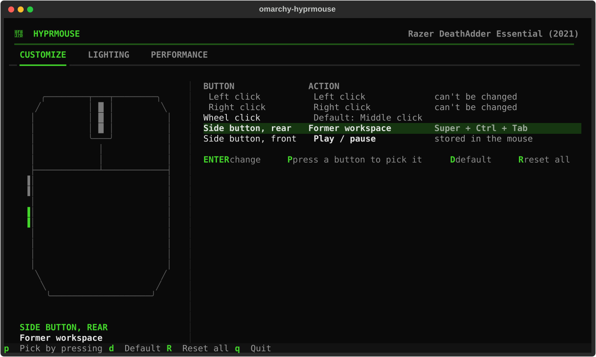
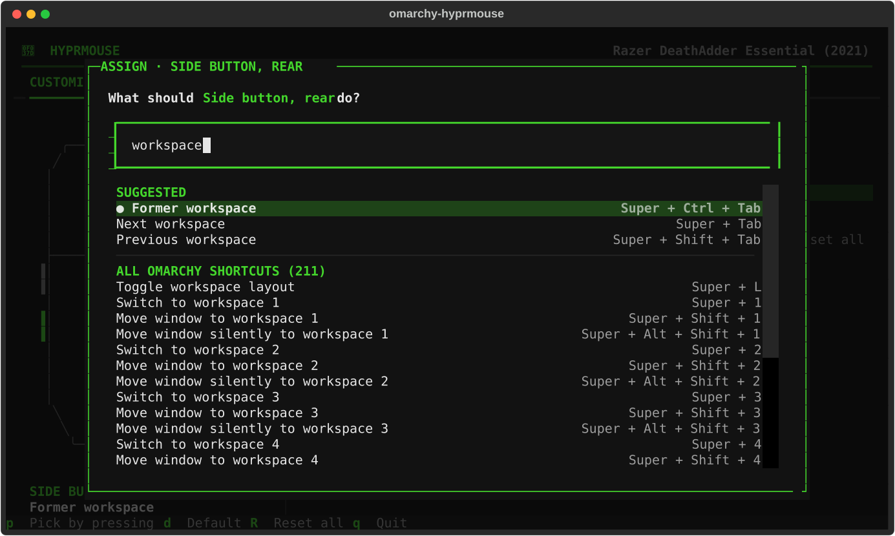
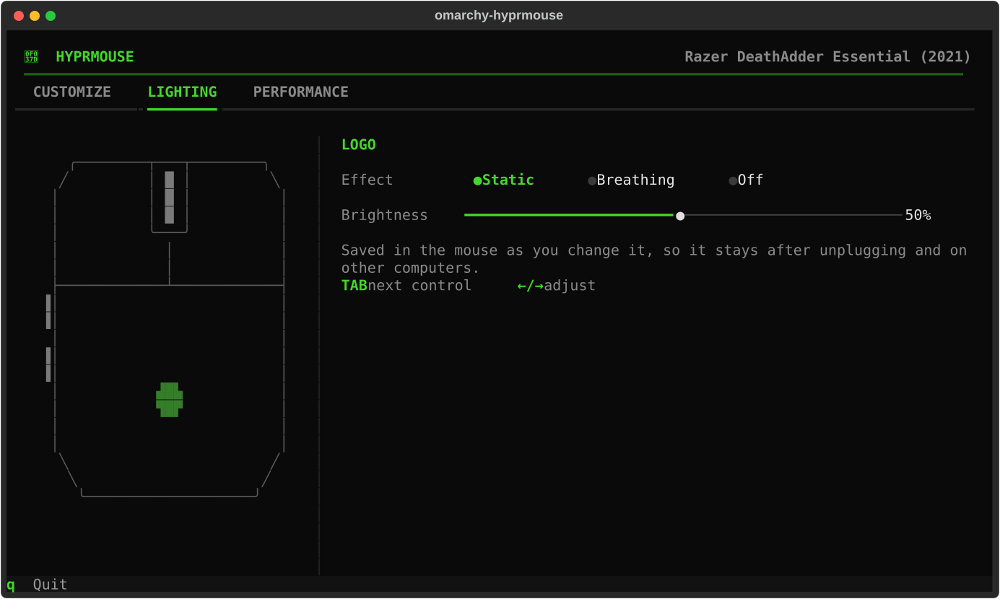
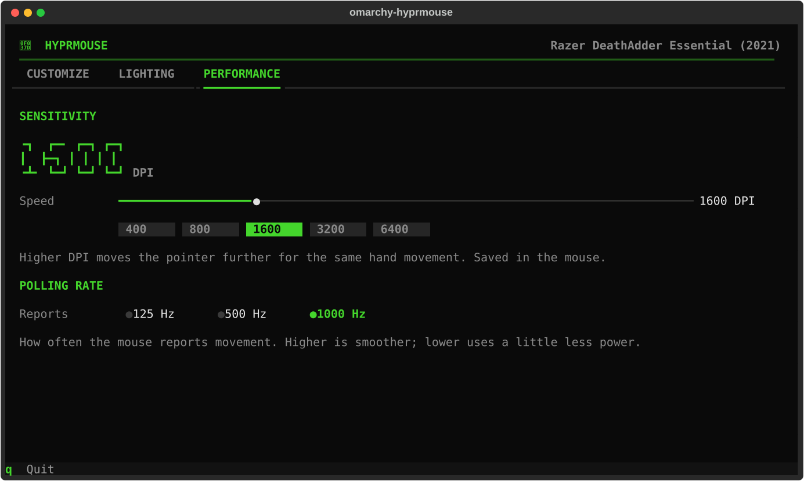

# omarchy-hyprmouse

**Make every mouse button do something useful on [Omarchy](https://omarchy.org).** Pick a button,
search for any Omarchy hotkey ("former workspace", "screenshot", "close window"…), done. For
supported mice it also unlocks what's stored *inside* the mouse: buttons turned off by vendor
software, on-mouse media keys, lighting, DPI and polling rate. No Windows, no Synapse.



## What it does

**Customize** works with any mouse, any brand:

- Wheel click, side buttons and extra buttons can run **any Omarchy hotkey** (all of them,
  including ones that run Lua functions such as *Universal copy*), **a command**, or **a key
  combination**, or do **nothing**.
- **Press P, then the button** you want to change. No need to know its name.
- Changes apply instantly. Left and right click are locked so you can never lose clicking.



**Hardware features**, for mice that have a profile (see the list below):

- Re-enable buttons the mouse itself has turned off (a common leftover from Razer Synapse).
- Store **media keys on the mouse**, so they work on any computer.
- **Lighting**: static, breathing or off, plus brightness, previewed live on a drawing of your mouse.
- **Performance**: DPI with presets, and polling rate.

Everything stored in the mouse stays after unplugging and works on other computers.

| Lighting | Performance |
| --- | --- |
|  |  |

## Supported mice

| Mouse | Button remapping | Stored in the mouse | Status |
| --- | --- | --- | --- |
| Any mouse with extra buttons | ✓ | | works through Hyprland |
| Razer DeathAdder Essential (2021) `1532:0098` | ✓ | buttons, logo lighting, DPI, polling | verified |
| Razer DeathAdder Essential `1532:006e` | ✓ | buttons, logo + wheel lighting, DPI, polling | from OpenRazer data, unconfirmed |
| Razer DeathAdder Essential (White) `1532:0071` | ✓ | buttons, logo + wheel lighting, DPI, polling | from OpenRazer data, unconfirmed |

Most Razer mice speak the same protocol, so **adding one is usually a single small file**. Other
brands need a driver. Both are explained in [CONTRIBUTING.md](CONTRIBUTING.md). If you own one of
the unconfirmed mice, please run `omarchy-hyprmouse --doctor` and tell us how it went.

## Install

```sh
yay -S omarchy-hyprmouse     # or: paru -S omarchy-hyprmouse
```

Then run `omarchy-hyprmouse` once (or open **Mouse (hyprmouse)** from the app launcher). From
then on it's in the **Omarchy menu → Setup → Mouse**.

The package's udev rule gives your session access to supported mice, so no password is needed.
For a mouse described by your own profile, the app offers a one-time setup with a single password
prompt.

## Keys

| Key | |
| --- | --- |
| `Enter` | change the selected button |
| `P` | press a mouse button to select it |
| `D` / `R` | back to default / reset all buttons |
| `1` `2` `3` | Customize / Lighting / Performance |
| `Tab`, `←` `→` | move between controls, adjust sliders |
| `Q` | quit |

## How it works

- **Hotkeys.** A tiny Lua module (`~/.config/hypr/hyprmouse_capture.lua`) loads before Omarchy's
  defaults and remembers the action behind every hotkey as it's bound. Mouse buttons then reuse
  that exact action, so if you later change what a hotkey does, the button follows.
- **Buttons.** Your choices live in `~/.config/omarchy-hyprmouse/settings.json` and are written
  to `~/.config/hypr/hyprmouse.lua` as plain Hyprland binds (`mouse:275` and so on). That file is
  self-contained and keeps working even if the package is removed.
- **The mouse itself.** Drivers talk to the mouse's own memory over HID (Razer: the same 90-byte
  feature reports Synapse uses, documented by [OpenRazer](https://github.com/openrazer/openrazer)).
  Each write is read back to confirm the mouse kept it.
- **Staying wired.** If `omarchy refresh hyprland` or an update resets `hyprland.lua`, Omarchy's
  post-boot and post-update hooks run `omarchy-hyprmouse --repair` to put the two `require`
  lines back.

### Files it touches

| Path | What |
| --- | --- |
| `~/.config/hypr/hyprland.lua` | two `require` lines (a backup is made first) |
| `~/.config/hypr/hyprmouse_capture.lua`, `hyprmouse.lua` | the modules above |
| `~/.config/omarchy/extensions/omarchy-menu.jsonc` | the *Setup → Mouse* entry |
| `~/.config/omarchy/hooks/post-{boot,update}.d/omarchy-hyprmouse` | repair hooks |
| `~/.config/omarchy-hyprmouse/` | your settings, and your own mouse profiles |

## Commands

```sh
omarchy-hyprmouse              # open the app
omarchy-hyprmouse --doctor     # what's detected, wired and readable (add --scan for raw device state)
omarchy-hyprmouse --repair     # re-wire Hyprland (the hooks run this)
omarchy-hyprmouse --udev-rules # print udev rules for every known mouse
omarchy-hyprmouse --uninstall  # remove its wiring, menu entry and hooks from your config
```

## Uninstall

```sh
omarchy-hyprmouse --uninstall && yay -R omarchy-hyprmouse
```

Settings stored inside the mouse stay as they are. Set buttons back to *Default* first if you want
the mouse exactly as it came.

## Credits

Razer protocol details come from the [OpenRazer](https://github.com/openrazer/openrazer) project's
reverse engineering. Not affiliated with Razer or Omarchy.

## License

MIT
